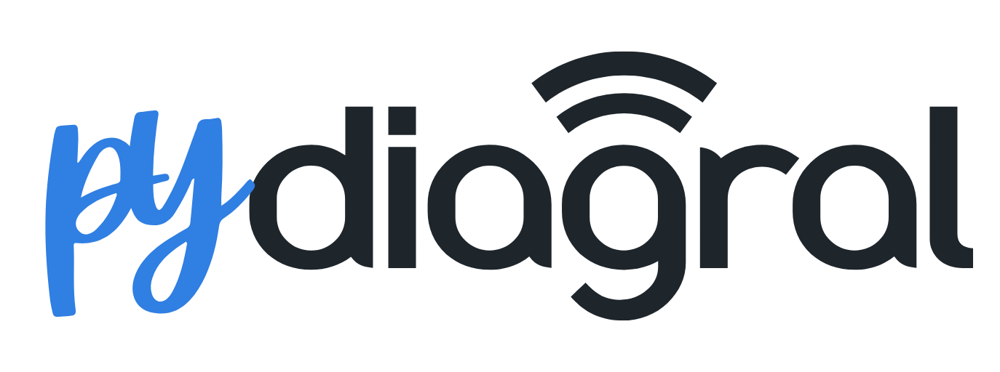

# Documentation pydiagral

Welcome to the documentation for pydiagral, a Python library for interacting with the Diagral API.

## About pydiagral

pydiagral is an asynchronous Python interface for the Diagral alarm system. This library allows users to control and monitor their Diagral alarm system through the official API.

!!! danger "Caution"

    Please note that the Diagral alarm system is a security system, and it may be preferable not to connect it to any automation platform for security reasons.
    In no event shall the developer of [`pydiagral`](https://github.com/mguyard/pydiagral) library be held liable for any issues arising from the use of this [`pydiagral`](https://github.com/mguyard/pydiagral) library.
    The user installs and uses this integration at their own risk and with full knowledge of the potential implications.

## Requirement

To use this library, which leverages the Diagral APIs, you must have a Diagral box (DIAG56AAX or DIAG59AAX). This box connects your Diagral alarm system to the internet, enabling interaction with the alarm system via the API.
__DIAG56AAX is End of Sales but you can find more information about the [DIAG59AAX](https://www.diagral.fr/2026/01/19/nouvelle-centrale-dalarme-ip-4g-diagral-diag99agx/) available inside the DIAG99AGX.__

## Key Features

The `DiagralAPI` class offers the following functionalities:

- **Authentication**:

  - Connect to the Diagral API with username and password
  - Log in to obtain an access token
  - Create, validate, and delete API keys
  - List the systems of the account and their API keys, to discover the serial IDs

- **System Configuration**:

  - Retrieve alarm configuration

- **System Information**:

  - Obtain system details
  - Retrieve the current system status
  - Check that the Diagral cloud answers (health check, no credential needed)
  - Manage webhooks
  - Manage anomalies

- **System Interraction**:
  - Activate or Desactivate system (partially or globally)
  - List automatism rules (running their actions is not implemented yet)

## Untested features

Some parts of pydiagral are built from the Diagral API documentation only, because they could not be checked on a real installation:

- **Cameras**: `AlarmConfiguration.cameras` follows the `CameraModel` of the Diagral OpenAPI specification. pydiagral logs a warning once when a configuration includes cameras.

If you own the matching equipment, please [open an issue](https://github.com/mguyard/pydiagral/issues) describing what you observe, with the `cameras` part of the configuration Diagral sends. pydiagral logs that configuration at debug level, on the line starting with `Parsing AlarmConfiguration from`. To get it, enable the `pydiagral` logger at debug level, with `logging.getLogger("pydiagral").setLevel(logging.DEBUG)`, or in Home Assistant with `pydiagral: debug` under `logger: logs:`. Keys, tokens, PIN codes and serial numbers are redacted, but the line still shows the names of your devices: read it before posting.

## Quick Start

To get started with pydiagral, follow these steps:

1. Installation:

   ```bash
   pip install pydiagral
   ```

2. Example

A modular and easy-to-use test script is available [example_code.py](https://github.com/mguyard/pydiagral/blob/main/example_code.py) to help you get started with the library.

Simply create a `.env` file with the following content:

```properties
USERNAME=your_email@example.com
PASSWORD=your_password
SERIAL_ID=your_serial_id
PIN_CODE=your_pin_code  // Also named Master Code
LOG_LEVEL=DEBUG
```

And run the [example_code.py](https://github.com/mguyard/pydiagral/blob/main/example_code.py).

> TIP
>
> You can customize the actions performed by [example_code.py](https://github.com/mguyard/pydiagral/blob/main/example_code.py) by modifying the parameters in the code, as indicated by the `CUSTOMIZE THE TESTS` section title.

3. Request timeout

Each request to the Diagral cloud may take up to 30 seconds. To allow more, set `request_timeout` (in seconds) when creating the client:

```python
async with DiagralAPI(
    username=username,
    password=password,
    serial_id=serial_id,
    request_timeout=60,
) as diagral:
    ...
```

To give a single call a shorter deadline, wrap it in `asyncio.timeout()`. That deadline cannot exceed `request_timeout`.

4. Shared session

To send requests through an `aiohttp.ClientSession` you already manage, pass it as `session`. The client uses it as is and never closes it:

```python
async with aiohttp.ClientSession() as session:
    async with DiagralAPI(
        username=username,
        password=password,
        serial_id=serial_id,
        session=session,
    ) as diagral:
        ...
```

Without `session`, the client opens its own on `async with` and closes it on exit.

5. Brand

Diagral shares its cloud with sister brands. For an account of another brand, set `vendor` when creating the client, to one of `DIAGRAL` (the default), `DAITEM`, `EDAITEM`, `LOGISTYALMA` or `DISTRIBUTION`, in any case:

```python
async with DiagralAPI(
    username=username,
    password=password,
    serial_id=serial_id,
    vendor="DAITEM",
) as diagral:
    ...
```

6. Discover the serial IDs

Without a serial ID, the client can still log in and list the systems of the account. Create it with the serial ID you pick to use every other call:

```python
async with DiagralAPI(username=username, password=password) as diagral:
    systems = await diagral.get_systems()
serial_id = systems[0].serial_id
```

## API Structure

For detailed API documentation, please refer to the following sections:

- [API Reference](api.md): Comprehensive documentation of the DiagralAPI class and its methods
- [Data Models](models.md): Description of the data structures used
- [Exceptions](exceptions.md): List of package exceptions

## Contribution

Contributions to pydiagral are welcome! Please check our contribution guidelines for more information on how to participate in the development of this library.

## License

pydiagral is distributed under the GPL-v3 License. See the [LICENSE](https://github.com/mguyard/pydiagral/blob/main/LICENSE) file for more details.
